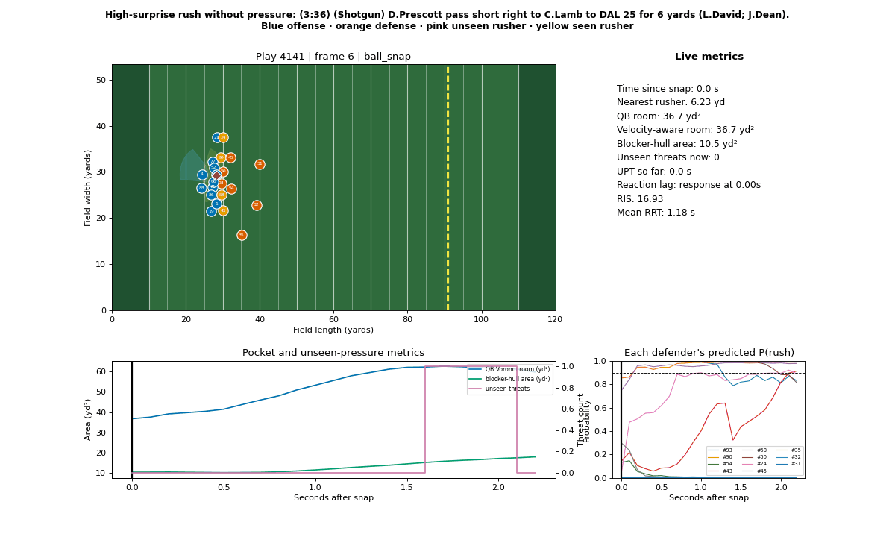

We quantify quarterback situational awareness under pressure by measuring how long QBs take to turn toward and move away from pass rushers approaching outside their body-facing view cone. Using player-tracking data, we introduce Unseen Pressure Time (UPT), the duration for which a quarterback is exposed to a nearby, closing pass rusher outside that view cone, and measure reaction through changes in body orientation, displacement, and movement direction. Across 8,557 passing plays, pressured plays averaged 1.15 seconds of UPT, compared with 0.72 seconds on non-pressured plays—a difference of 0.42 seconds (95% CI: 0.39–0.46). Plays with any UPT also produced pressure 40.0% of the time, versus 20.2% when UPT was zero, demonstrating that the metric captures meaningful pressure exposure. We investigate whether defensive disguise delays quarterback reactions and whether longer reaction times help explain hurries, hits, and sacks. By accounting for plays where a throw or sack occurs before a measurable response, we aim to identify vulnerabilities in quarterback awareness, evaluate how effectively quarterbacks navigate pressure, and uncover opportunities for coaches to improve decision-making, pocket movement, and pressure recognition.

